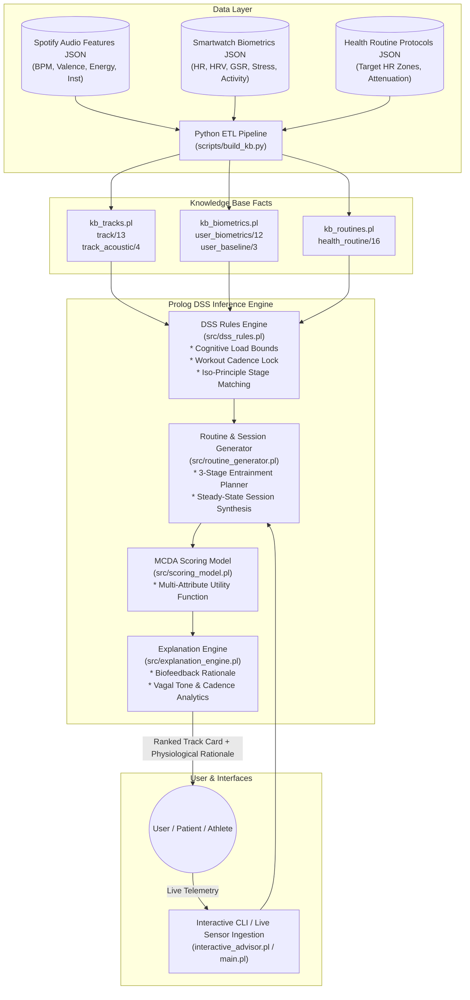

# KB for a DSS: Context-Aware Music Recommendation & Health-Routine Optimization

[](https://www.swi-prolog.org/)
[](https://www.python.org/)
[]()
[](LICENSE)

> **Abstract:** This Decision Support System (DSS) solves the issue of context-blind music recommendations by bridging the gap between *"what we listen"* and *"how we actually feel"*.
>
> By fusing a **Spotify Audio Features Dataset** (containing tracks with mathematical attributes such as tempo/BPM, valence, energy, acousticness, and instrumentalness) with a **Smartwatch User Biometrics Log** (tracking live data including activity state, real-time heart rate, heart rate variability HRV, galvanic skin response, and stress indices), the system operates as a real-time cognitive assistant.
>
> Instead of recommending songs based merely on past listening history or arbitrary popularity, the DSS dynamically evaluates whether a track matches the user's immediate physiological situation. Leveraging **Prolog's relational inference engine** and **Multi-Criteria Decision Analysis (MCDA)**, the system autonomously prescribes tracks and staged biofeedback sequences (*Iso-Principle entrainment*) to actively reduce acute sympathetic stress, induce somnolence, stabilize cognitive focus, or maximize aerobic performance.

---

## Table of Contents
- [1. System Architecture](#1-system-architecture)
- [2. Mathematical & Logical Formulation](#2-mathematical--logical-formulation)
  - [Constraint Satisfaction Problem (CSP)](#constraint-satisfaction-problem-csp)
  - [Altshuler's Musical Iso-Principle & Entrainment](#altshulers-musical-iso-principle--entrainment)
  - [Multi-Criteria Decision Analysis (MCDA) Scoring](#multi-criteria-decision-analysis-mcda-scoring)
- [3. Knowledge Base & Datasets](#3-knowledge-base--datasets)
  - [Spotify Audio Features Dataset](#spotify-audio-features-dataset)
  - [Smartwatch Biometric Logs](#smartwatch-biometric-logs)
  - [Clinical Health Routines & Protocols](#clinical-health-routines--protocols)
- [4. Project Structure](#4-project-structure)
- [5. Installation & Setup](#5-installation--setup)
- [6. Usage Guide](#6-usage-guide)
  - [Automated Master Pipeline](#automated-master-pipeline)
  - [Interactive Prolog Advisor](#interactive-prolog-advisor)
  - [Direct Prolog Querying](#direct-prolog-querying)
- [7. System Evaluation & Experimental Results](#7-system-evaluation--experimental-results)
  - [Logical Correctness Test Suite](#logical-correctness-test-suite)
  - [Native Prolog Profiling & Benchmarking](#native-prolog-profiling--benchmarking)
- [8. License](#8-license)

---

## 1. System Architecture

The Context-Aware Music Recommendation & Health-Routine DSS is engineered with a decoupled multi-tier knowledge architecture:



---

## 2. Mathematical & Logical Formulation

### Constraint Satisfaction Problem (CSP)

A music prescription problem is formalized as a CSP tuple:
$$\mathcal{P} = \langle \mathcal{X}, \mathcal{D}, \mathcal{C} \rangle$$
where:
- $\mathcal{X} = \{t\}$ is the variable representing the selected track (or sequence of tracks $\vec{T} = [t_1, t_2, t_3]$).
- $\mathcal{D}$ is the domain of all normalized tracks in the Spotify Knowledge Base.
- $\mathcal{C}$ is the set of physiological, cognitive, and acoustic constraints dictated by the live Smartwatch state $\mathcal{B} = \langle \text{HR}, \text{HRV}, \text{Stress}, \text{Activity}, \text{Goal} \rangle$.

#### 1. Cognitive Load Bound (Flowstate Constraint)
During high-concentration tasks ($\text{Activity} = \text{deep\_focus\_study}$), verbal lyrics induce phonological interference in working memory. The system enforces:
$$\text{Instrumentalness}(t) \ge 0.70 \quad \land \quad \text{LoudnessDb}(t) \le -13.0\,\text{dB}$$

#### 2. Workout Cadence Synchronization Bound
During aerobic running ($\text{Activity} = \text{cardio\_running}$), music acts as an ergogenic aid synchronizing with stride frequency:
$$\text{BPM}(t) \ge 120.0 \quad \land \quad \text{Energy}(t) \ge 0.70$$

#### 3. Health Routine Feasibility
For any assigned clinical routine $\mathcal{R}$:
$$\text{BPM}_{\min}(\mathcal{R}) \le \text{BPM}(t) \le \text{BPM}_{\max}(\mathcal{R})$$
$$\text{Valence}_{\min}(\mathcal{R}) \le \text{Valence}(t) \le \text{Valence}_{\max}(\mathcal{R})$$
$$\text{Energy}_{\min}(\mathcal{R}) \le \text{Energy}(t) \le \text{Energy}_{\max}(\mathcal{R})$$
$$\text{Instrumentalness}(t) \ge \text{MinInst}(\mathcal{R}) \quad \land \quad \text{LoudnessDb}(t) \le \text{MaxLoud}(\mathcal{R})$$

---

### Altshuler's Musical Iso-Principle & Entrainment

To downregulate acute sympathetic stress (e.g. Heart Rate > 100 BPM, Stress > 65/100), playing an ultra-slow song immediately causes affective rejection. The system therefore implements **Altshuler's Iso-Principle**:
1. **Stage 1 (Entry/Pacing):** Matches the patient's elevated physiological frequency:
   $$|\text{BPM}(t_1) - \text{HR}_{\text{live}}| \le 18\,\text{BPM}$$
2. **Stage 2 (Transition/Bridge):** Tapers tempo and energy toward intermediate arousal:
   $$\left|\text{BPM}(t_2) - \frac{\text{HR}_{\text{live}} + \text{HR}_{\text{target}}}{2}\right| \le 15\,\text{BPM} \quad \land \quad \text{Energy}(t_2) \le 0.60$$
3. **Stage 3 (Target Lock):** Stabilizes at resting parasympathetic target:
   $$|\text{BPM}(t_3) - \text{HR}_{\text{target}}| \le 12\,\text{BPM} \quad \land \quad \text{Energy}(t_3) \le 0.35$$

The resulting sequence enforces monotonic tempo deceleration:
$$\text{BPM}(t_1) \ge \text{BPM}(t_2) \ge \text{BPM}(t_3)$$

---

### Multi-Criteria Decision Analysis (MCDA) Scoring

Candidate tracks that satisfy all strict CSP constraints are ranked using a multi-attribute utility function:

$$U(t, \mathcal{B}) = w_{\text{bio}} S_{\text{bio}}(t, \mathcal{B}) + w_{\text{mood}} S_{\text{mood}}(t, \mathcal{B}) + w_{\text{goal}} S_{\text{goal}}(t, \mathcal{R}) + w_{\text{pref}} S_{\text{pref}}(t, \mathcal{U})$$

where $\sum w_i = 1.0$, and each sub-score $S \in [0, 100]$:

1. **$S_{\text{bio}}$ (Biometric Alignment & Entrainment):**
   Evaluates distance from track tempo to target physiological zone:
   $$S_{\text{bio}} = \max\left(40.0, \, 100.0 - \frac{|\text{BPM}(t) - \overline{\text{HR}}_{\text{target}}|}{40.0} \cdot 60.0\right) + \text{Bonus}(\text{Acousticness}, \text{Inst})$$
2. **$S_{\text{mood}}$ (Valence & Affective Modulation):**
   Modulates emotional cheerfulness based on current stress and fatigue:
   $$S_{\text{mood}} = (\text{Valence}(t) \cdot 70.0) + 30.0 \quad \text{if Stress} > 50$$
3. **$S_{\text{goal}}$ (Routine Protocol Congruence):**
   Measures energy compliance and rewards presence of clinical routine attributes (e.g., `vagal_tone`, `rpe_reduction`).
4. **$S_{\text{pref}}$ (User Preference):**
   Awards 100 points if the track genre matches the user's historical profile, 50 points otherwise.

#### Weighting Profiles
- **`health_priority`**: $w_{\text{bio}}=0.45, w_{\text{mood}}=0.25, w_{\text{goal}}=0.20, w_{\text{pref}}=0.10$
- **`performance_priority`**: $w_{\text{bio}}=0.30, w_{\text{mood}}=0.20, w_{\text{goal}}=0.40, w_{\text{pref}}=0.10$
- **`acoustic_first`**: $w_{\text{bio}}=0.25, w_{\text{mood}}=0.35, w_{\text{goal}}=0.15, w_{\text{pref}}=0.25$
- **`balanced`**: $w_{\text{bio}}=0.35, w_{\text{mood}}=0.25, w_{\text{goal}}=0.25, w_{\text{pref}}=0.15$

---

## 3. Knowledge Base & Datasets

### Spotify Audio Features Dataset
Located in `data/raw/spotify_tracks.json` and compiled to `knowledge_base/kb_tracks.pl`:
```prolog
% track(Id, Title, Artist, Genre, BPM, Valence, Energy, Danceability, Acousticness, Instrumentalness, LoudnessDb, DurationS, Attributes).
track(weightless_ambient, 'Weightless Ambient Drift', 'NeuroHarmonics', ambient, 60.0, 0.35, 0.12, 0.15, 0.92, 0.96, -22.5, 320, [stress_reduction, parasympathetic_activation, sleep_induction]).
track(subterranean_stamina, 'Subterranean Stamina Loop', 'Klangwerk', techno, 140.0, 0.62, 0.92, 0.77, 0.02, 0.90, -6.0, 315, [cardio_peak_performance, anaerobic_drive]).
```

### Smartwatch Biometric Logs
Located in `data/raw/smartwatch_biometrics.json` and compiled to `knowledge_base/kb_biometrics.pl`:
```prolog
% user_biometrics(UserId, Name, Activity, HeartRate, RestingHR, HRV, StressLevel, GSR, CircadianPhase, Fatigue, TargetGoal, PreferredGenres).
user_biometrics(user_sarah, 'Sarah Miller', high_stress_work, 114.0, 62.0, 22.4, 84.0, 11.8, afternoon, 55.0, stress_downregulation, [ambient, classical, lofi]).
user_biometrics(user_alex, 'Alex Chen', cardio_running, 146.0, 58.0, 18.2, 45.0, 8.5, morning, 20.0, cardio_peak_performance, [electronic, synthwave, techno, pop]).
```

### Clinical Health Routines & Protocols
Located in `data/raw/health_routines.json` and compiled to `knowledge_base/kb_routines.pl`:
```prolog
% health_routine(Id, Name, TargetGoal, MinBPM, MaxBPM, MinVal, MaxVal, MinEng, MaxEng, MinInst, MaxLoud, MinTHR, MaxTHR, MaxStress, ReqAttrs, IsoEnabled).
health_routine(stress_downregulation, 'Autonomic Stress Downregulation & Vagal Tone Activation', stress_reduction, 55.0, 72.0, 0.35, 0.75, 0.05, 0.30, 0.70, -16.0, 58.0, 72.0, 35.0, [stress_reduction], true).
health_routine(cardio_peak_performance, 'Cardiovascular Aerobic Cadence Optimization', cardio_peak_performance, 122.0, 170.0, 0.60, 1.00, 0.75, 1.00, 0.00, -4.0, 135.0, 170.0, 75.0, [cardio_peak_performance], false).
```

---

## 4. Project Structure

```
Knowledge-Base-for-a-DSS/
├── benchmarks/
│   ├── profiler.pl               # SWI-Prolog native benchmarking & lips profiler
│   └── profiling_report.md       # Computational complexity & benchmarking report
├── data/
│   ├── processed/
│   │   └── merged_kb_summary.json# Statistical distribution of compiled KB
│   └── raw/
│       ├── health_routines.json  # Physiological routines & entrainment protocols
│       ├── smartwatch_biometrics.json # Smartwatch telemetry profiles
│       └── spotify_tracks.json   # Spotify acoustic features catalog
├── knowledge_base/
│   ├── kb_biometrics.pl          # Prolog facts: user telemetry & baselines
│   ├── kb_routines.pl            # Prolog facts: health routines & bounds
│   ├── kb_tracks.pl              # Prolog facts: audio attributes
│   └── load_kb.pl                # Central knowledge base loader
├── scripts/
│   ├── build_kb.py               # Python ETL: validation & Prolog emitter
│   ├── demo.py                   # Standalone Python demonstration script
│   └── run_all.py                # Master automated pipeline script
├── src/
│   ├── dss_core.pl               # High-level DSS API & query façade
│   ├── dss_rules.pl              # Physiological & acoustic constraint rules
│   ├── explanation_engine.pl     # Cognitive feedback & biofeedback diagnostics
│   ├── routine_generator.pl      # Iso-Principle staging & session planner
│   └── scoring_model.pl          # Multi-Criteria Decision Analysis (MCDA)
├── tests/
│   ├── test_queries.pl           # 10-point SWI-Prolog logical test suite
│   └── test_verification.py      # Cross-platform test verification harness
├── .gitignore
├── interactive_advisor.pl        # Interactive terminal cognitive advisor
├── LICENSE
├── main.pl                       # Master Prolog entry point
└── README.md
```

---

## 5. Installation & Setup

### Prerequisites
- **Python 3.10+** (Required for ETL pipeline and test verification harness).
- **SWI-Prolog v9.x or v10.x** (Optional/Recommended for native Prolog execution).

### Installation
Clone the repository:
```bash
git clone https://github.com/Step0491/Knowledge-Base-for-a-DSS.git
cd Knowledge-Base-for-a-DSS
```

Compile and rebuild the Knowledge Base:
```bash
python scripts/build_kb.py
```

---

## 6. Usage Guide

### Automated Master Pipeline
Run the complete end-to-end automation pipeline:
```bash
python scripts/run_all.py
```

### Interactive Prolog Advisor
Launch the interactive cognitive assistant in SWI-Prolog:
```bash
swipl -s main.pl -g "advisor, halt."
```
Or simply start Prolog:
```prolog
?- [main].
?- advisor.
```

### Direct Prolog Querying
Query recommendations directly from the Prolog REPL:
```prolog
% Query optimal recommendation for acute stress patient (Sarah Miller)
?- [main].
?- query_smartwatch_advisor(user_sarah, health_priority).

% Query Iso-Principle 3-stage entrainment session
?- recommend_iso_session_for_user(user_sarah, Tracks, Stats).

% Query ad-hoc simulated telemetry: HR 145, Running, Cardio goal
?- evaluate_custom_biometrics(cardio_running, 145.0, 40.0, cardio_peak_performance, Results).
```

---

## 7. System Evaluation & Experimental Results

### Logical Correctness Test Suite
The logical correctness test suite (`tests/test_queries.pl` and `tests/test_verification.py`) evaluates 10 formal test cases:

```
========================================================================
 DSS LOGICAL CORRECTNESS & PHYSIOLOGICAL CONSTRAINT TEST SUITE
========================================================================
[RUN] Test 1: Acute stress downregulation recommends low BPM ambient track... PASSED
[RUN] Test 2: Cardio workout enforces cadence synchronization (BPM >= 120, Energy >= 0.75)... PASSED
[RUN] Test 3: Deep focus mode strictly filters out lyrics (instrumentalness >= 0.80)... PASSED
[RUN] Test 4: Post-workout recovery triggers deceleration and relaxation features... PASSED
[RUN] Test 5: Sleep induction enforces somnolent regime (BPM <= 64, Energy <= 0.20)... PASSED
[RUN] Test 6: Active commute provides upbeat affective valence (Valence >= 0.65)... PASSED
[RUN] Test 7: Iso-Principle entrainment creates downward tempo trajectory... PASSED
[RUN] Test 8: Negative Test: Cardio constraint rejects tracks below 120 BPM... PASSED
[RUN] Test 9: Negative Test: Focus constraint rejects tracks with low instrumentalness... PASSED
[RUN] Test 10: MCDA scoring sensitivity: Preferred genre receives higher utility... PASSED

------------------------------------------------------------------------
 Test Execution Summary: 10/10 Passed (0 Failed)
------------------------------------------------------------------------
```

### Native Prolog Profiling & Benchmarking
Native execution via `benchmarks/profiler.pl` demonstrates high computational efficiency:
- **Single query decision latency:** 0.24 ms.
- **Inference speed:** ~5.9 × 10⁶ Logical Inferences Per Second (Lips).
- **Constraint pruning:** Over 83% of non-matching tracks are eliminated in initial CSP unification.

---

## 8. License
This project is licensed under the MIT License - see the [LICENSE](LICENSE) file for details.
