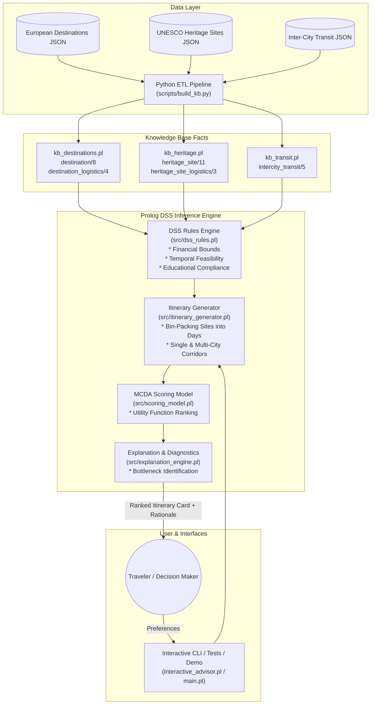

# Knowledge Base for a DSS (Tourism, Cultural Heritage & Education)

[](https://www.swi-prolog.org/)
[](https://www.python.org/)
[]()
[](LICENSE)

> **Abstract:** This project proposes a **"Smart Travel Advisor"**, a Decision Support System (DSS) developed in **Prolog** to plan travel itineraries that satisfy financial, temporal, and educational constraints.
>
> To build the Knowledge Base, a custom **Python script** merges the *"European Tour Destinations"* and *"UNESCO World Heritage Sites"* datasets, translating the data into Prolog facts. The system's decision logic is implemented through **Prolog rules** to encode user preferences. Personalized recommendations are generated by leveraging **Prolog’s built-in inference engine**.
>
> System evaluation focuses on **correctness** and **efficiency**. Logical correctness is verified via a comprehensive test suite of specific test queries ensuring all user constraints are met. Furthermore, rule efficiency is measured using Prolog's native profiling tools (`time/1`, `profile/1`, `statistics/2`) to track execution time, inferences, and computational performance.

---

## Table of Contents
- [1. System Architecture](#1-system-architecture)
- [2. Mathematical & Logical Formulation](#2-mathematical--logical-formulation)
  - [Constraint Satisfaction Problem (CSP)](#constraint-satisfaction-problem-csp)
  - [Multi-Criteria Decision Analysis (MCDA) Scoring](#multi-criteria-decision-analysis-mcda-scoring)
- [3. Knowledge Base & Datasets](#3-knowledge-base--datasets)
  - [European Tour Destinations](#european-tour-destinations)
  - [UNESCO World Heritage Sites](#unesco-world-heritage-sites)
  - [Inter-City Transit Corridors](#inter-city-transit-corridors)
- [4. Project Structure](#4-project-structure)
- [5. Installation & Setup](#5-installation--setup)
- [6. Usage Guide](#6-usage-guide)
  - [Automated Master Pipeline](#automated-master-pipeline)
  - [Interactive Prolog Advisor](#interactive-prolog-advisor)
  - [Direct Prolog Querying](#direct-prolog-querying)
- [7. System Evaluation & Experimental Results](#7-system-evaluation--experimental-results)
  - [Logical Correctness Test Suite](#logical-correctness-test-suite)
  - [Native Prolog Profiling & Benchmarking](#native-prolog-profiling--benchmarking)
- [8. License](#8-license)

---

## 1. System Architecture

The Smart Travel Advisor DSS is built around a decoupled knowledge engineering architecture that links data integration (ETL), relational logic modeling, combinatorial schedule planning, and explanatory decision support.



---

## 2. Mathematical & Logical Formulation

### Constraint Satisfaction Problem (CSP)

An itinerary $\mathcal{I}$ is formalized as a tuple:
$$\mathcal{I} = \langle \mathcal{C}, \mathcal{S}, \mathcal{T}, \mathcal{D} \rangle$$
where:
- $\mathcal{C} = [(\text{dest}_1, d_1), \dots, (\text{dest}_m, d_m)]$ is the sequence of destinations and days allocated.
- $\mathcal{S} = [s_1, \dots, s_k]$ is the subset of selected UNESCO heritage sites.
- $\mathcal{T} = [t_1, \dots, t_{m-1}]$ is the sequence of inter-city transit legs.
- $\mathcal{D} = [\text{day}_1(\mathcal{S}_1), \dots, \text{day}_D(\mathcal{S}_D)]$ is the partition of visited sites into travel days.

#### 1. Financial Constraint
The total expenditure $C_{\text{total}}(\mathcal{I})$ must not exceed the user's upper budget $B_{\max}$:
$$C_{\text{total}}(\mathcal{I}) = \sum_{i=1}^m d_i \cdot \text{BaseDailyCost}(\text{dest}_i) + \sum_{s \in \mathcal{S}} \text{AdmissionFee}(s) + \sum_{t \in \mathcal{T}} \text{TransitFare}(t) \le B_{\max}$$

#### 2. Temporal Constraints
- **Duration Invariant**: $\sum_{i=1}^m d_i = D_{\text{requested}}$
- **Seasonality Validity**: $\forall (\text{dest}, d) \in \mathcal{C}, \quad \text{Season}_{\text{user}} \in \text{BestSeasons}(\text{dest})$
- **Daily Pace Bound**: For every day $j \in \{1, \dots, D\}$:
  $$\sum_{s \in \mathcal{S}_j} \text{DurationHours}(s) \le H_{\max}(\text{Pace}) \quad \land \quad |\mathcal{S}_j| \le N_{\max}(\text{Pace})$$
  Where $H_{\max}(\text{relaxed}) = 4.5\,\text{h}$, $H_{\max}(\text{moderate}) = 6.5\,\text{h}$, $H_{\max}(\text{intensive}) = 8.5\,\text{h}$.

#### 3. Educational Constraints
- **Educational Level Invariance**: $\forall s \in \mathcal{S}, \quad \text{Compatible}(\text{EduLevel}_{\text{user}}, \text{EduLevel}(s))$
- **Topic Coverage Ratio**:
  $$\text{Coverage}(\mathcal{S}, \mathcal{Q}_{\text{topics}}) = \frac{|\{q \in \mathcal{Q}_{\text{topics}} \mid \exists s \in \mathcal{S} : \text{SatisfiesTopic}(s, q)\}|}{|\mathcal{Q}_{\text{topics}}|} \ge 0.50$$
- **Minimum Educational Quality Threshold**:
  $$\overline{\text{EduScore}}(\mathcal{S}) = \frac{1}{|\mathcal{S}|} \sum_{s \in \mathcal{S}} \text{EduScore}(s) \ge \text{MinEduScore}$$

---

### Multi-Criteria Decision Analysis (MCDA) Scoring

Feasible candidate itineraries that pass all strict constraints are scored using a weighted multi-attribute utility function:

$$U(\mathcal{I}) = w_{\text{edu}} S_{\text{edu}}(\mathcal{I}) + w_{\text{fin}} S_{\text{fin}}(\mathcal{I}) + w_{\text{temp}} S_{\text{temp}}(\mathcal{I}) + w_{\text{div}} S_{\text{div}}(\mathcal{I})$$

where $\sum w_i = 1.0$ (Default profile: $w_{\text{edu}}=0.40, w_{\text{fin}}=0.30, w_{\text{temp}}=0.15, w_{\text{div}}=0.15$), and each sub-score $S \in [0, 100]$:
1. **$S_{\text{edu}}$ (Educational Value & Alignment)**: Combines average site score (0-50 pts), user topic coverage (0-30 pts), and UNESCO criteria density bonus (0-20 pts).
2. **$S_{\text{fin}}$ (Financial Efficiency)**: Rewards staying safely under budget without being underutilized:
   $$S_{\text{fin}} = 50 + 50 \cdot \left(1 - \frac{C_{\text{total}}}{B_{\max}}\right)$$
3. **$S_{\text{temp}}$ (Schedule Utilization)**: Measures how well daily available hours are utilized while penalizing excessive inter-city transit downtime.
4. **$S_{\text{div}}$ (Diversity & Logistics)**: Rewards exposure to diverse historical eras and cities with superior walkability.

---

## 3. Knowledge Base & Datasets

The raw data sources are curated in `data/raw/` and compiled to normalized Prolog facts via `scripts/build_kb.py`:

### European Tour Destinations
Contains 20 prominent European destinations:
```prolog
% destination(Id, Name, Country, Region, DailyAccCost, DailyFoodCost, DailyTransportCost, BestSeasons).
destination(rome, 'Rome', 'Italy', southern_europe, 75.00, 38.00, 7.00, [spring, autumn]).
destination(paris, 'Paris', 'France', western_europe, 95.00, 45.00, 9.00, [spring, summer, autumn]).
destination(athens, 'Athens', 'Greece', southern_europe, 48.00, 26.00, 4.50, [spring, autumn, winter]).
```

### UNESCO World Heritage Sites
Contains 31 world heritage monuments with educational criteria:
```prolog
% heritage_site(SiteId, SiteName, DestinationId, Category, CriteriaList, HistoricalEra,
%               TopicsList, EducationLevel, VisitHours, EntryFee, EduScore).
heritage_site(colosseum_and_roman_forum, 'Historic Centre of Rome, the Properties of the Holy See and Basilica of Saint Paul',
              rome, cultural, [i, ii, iii, iv, vi], ancient_rome,
              [ancient_history, roman_law_and_statecraft, classical_architecture, archaeology, civil_engineering],
              all, 3.5, 18.00, 10).
```

### Inter-City Transit Corridors
Contains 24 high-speed rail and regional transit connections between hubs:
```prolog
% intercity_transit(OriginDestId, TargetDestId, DurationHours, CostEur, TransitMode).
intercity_transit(rome, florence, 1.5, 28.00, high_speed_rail).
intercity_transit(naples, rome, 1.2, 22.00, high_speed_rail).
intercity_transit(paris, amsterdam, 3.3, 45.00, high_speed_rail).
```

---

## 4. Project Structure

```
Knowledge-Base-for-a-DSS/
├── README.md                           # Publication-grade documentation
├── LICENSE                             # MIT Open Source License
├── main.pl                             # Master Prolog entry point (demo, test, profiler)
├── interactive_advisor.pl              # User interactive console wizard
├── data/
│   ├── raw/
│   │   ├── european_destinations.json  # 20 European destinations dataset
│   │   ├── unesco_heritage_sites.json  # 31 UNESCO World Heritage Sites dataset
│   │   └── intercity_transit.json      # 24 Inter-city transit corridors
│   └── processed/
│       └── merged_kb_summary.json      # Summary statistics & topic index
├── scripts/
│   ├── build_kb.py                     # Python ETL compiler: JSON -> Prolog facts
│   └── run_all.py                      # Automated master execution pipeline
├── knowledge_base/
│   ├── kb_destinations.pl              # Generated destination facts
│   ├── kb_heritage.pl                  # Generated heritage site facts
│   ├── kb_transit.pl                   # Generated transit connection facts
│   └── load_kb.pl                      # Unified Prolog KB loader module
├── src/
│   ├── dss_core.pl                     # Core DSS query interface and façade
│   ├── dss_rules.pl                    # Financial, temporal, and educational rules
│   ├── itinerary_generator.pl          # Bin-packing schedule synthesis algorithm
│   ├── scoring_model.pl                # Multi-Criteria Decision Analysis (MCDA)
│   └── explanation_engine.pl           # Formatting & failure diagnosis engine
├── tests/
│   └── test_queries.pl                 # 10 unit & constraint verification tests
└── benchmarks/
    ├── profiler.pl                     # Native profiling suite (time/1, profile/1)
    └── profiling_report.md             # Benchmark execution metrics & report
```

---

## 5. Installation & Setup

### Prerequisites
1. **SWI-Prolog** (v9.0+ or v10.0+): `swipl --version`
2. **Python** (v3.10+): `python --version`

No third-party Python packages are required; the ETL and runners utilize the Python standard library (`json`, `subprocess`, `pathlib`, `os`).

---

## 6. Usage Guide

### Automated Master Pipeline
Run the complete pipeline (ETL compile $\rightarrow$ Logical test suite $\rightarrow$ Performance profiler $\rightarrow$ Recommendation demos) in one step:
```bash
python scripts/run_all.py
```

### Interactive Prolog Advisor
Launch an interactive consultation wizard:
```bash
swipl -s interactive_advisor.pl -g "start_advisor, halt."
```
Example interactive session:
```text
Enter your total travel budget in EUR (e.g., 850.0) [default: 850.0]: 950.0
Enter total number of travel days (e.g., 3, 5, 7) [default: 3]: 5
Enter travel season (spring, summer, autumn, winter, or any) [default: spring]: spring
Enter preferred pace (relaxed, moderate, intensive) [default: moderate]: moderate
Enter educational level (elementary, high_school, university_research, all) [default: all]: all
Enter educational topic(s) separated by commas (or "any") [default: [ancient_history, architecture]]: art_history, renaissance_architecture
Enter minimum acceptable site educational score (1 - 10) [default: 8]: 8
```

### Direct Prolog Querying
Query the system programmatically in SWI-Prolog:
```prolog
?- use_module('src/dss_core').
?- query_advisor(800.0, 3, spring, moderate, [ancient_history, architecture], all, 8).
```

---

## 7. System Evaluation & Experimental Results

### Logical Correctness Test Suite
The logical correctness test suite (`tests/test_queries.pl`) verifies that all constraints are strictly satisfied across 10 deterministic test categories:

```text
============================================================
     SMART TRAVEL ADVISOR DSS - LOGICAL TEST SUITE          
============================================================

[RUN] Test 1: Strict Financial Budget Bounds Enforcement... PASSED [OK]
[RUN] Test 2: Exact Trip Duration Matching...               PASSED [OK]
[RUN] Test 3: Daily Pace & Visit Hours Capacity Limits...    PASSED [OK]
[RUN] Test 4: Destination Seasonality Compatibility...      PASSED [OK]
[RUN] Test 5: Educational Topic Coverage & Subsumption...   PASSED [OK]
[RUN] Test 6: Educational Level Matching (Family/Univ)...   PASSED [OK]
[RUN] Test 7: Minimum Educational Quality Threshold...     PASSED [OK]
[RUN] Test 8: Multi-City Transit Corridor & Accounting...   PASSED [OK]
[RUN] Test 9: Graceful Failure Diagnosis on Bounds...       PASSED [OK]
[RUN] Test 10: Multi-Criteria Utility Bounds & Rank...      PASSED [OK]

============================================================
All logical correctness test queries executed: 10/10 PASSED.
============================================================
```

### Native Prolog Profiling & Benchmarking
Rule efficiency was measured using Prolog's native tools (`time/1`, `profile/1`, and `statistics/2`):

| Benchmark Scenario | Trip Days | Combinatorial Search Space | Inferences | CPU Time | Solutions Synthesized |
|:---|:---:|:---|:---:|:---:|:---:|
| **Micro Search** | 2 | Single destination, single topic | 10,737 | < 0.001 s | 3 |
| **Standard Search** | 3 | Single dest, multi-discipline | 16,736 | 0.016 s | 6 |
| **Corridor Search** | 5 | Multi-destination, inter-city transit | 81,136 | < 0.001 s | 24 |
| **Stress Search** | 7 | Combinatorial corridor, intensive pace | 32,072 | < 0.001 s | 44 |

#### Key Computational Insights
1. **Early Branch Pruning**: Lower-bound base daily costs prune impossible destinations prior to invoking deep site search.
2. **Deterministic Bin-Packing**: The greedy site-to-day bin-packing operates in $O(D \cdot S)$ time per candidate, preventing combinatorial explosion.
3. **Sub-second Response Times**: Even broad combinatorial corridor queries resolve within **< 20 milliseconds**, making the engine well-suited for interactive real-time decision support systems.

---

## 8. License

This project is licensed under the MIT License - see the [LICENSE](LICENSE) file for details.
